  

  

Data Science & AI student at **PUC-GO** (Goiânia, Brazil) and IT Assistant at **Grupo Nisa**, where I build Python automations that turn weeks of manual work into hours. I like problems where data, automation and business rules meet.

`PT (native)` · `EN` · `IT` · `ES`

## ▸ Active projects

| Project | Mission | Stack |
|---|---|---|
| [**Flight Deal Finder**](https://github.com/matheussari/flight-deal-finder) | Telegram bot that searches airfare via a REST API, stores price history in SQLite and flags deals against the historical average | Python · SQLite · REST API · Telegram |
| [**MAPP**](https://github.com/matheussari/MAPP) | Predicts military aircraft combat radius; tuned XGBoost cut RMSE by 17.5% vs. baseline with repeated cross-validation | Scikit-learn · XGBoost · Plotly |
| [**Diabetes Classification Models**](https://github.com/matheussari/diabetes-classification-models) | Compares 6 classifiers for diabetes prediction, looking beyond accuracy to true positives | Scikit-learn · XGBoost |
| [**Dealership Sales Analysis**](https://github.com/matheussari/analise-vendas-concessionarias) | Exploratory analysis of 10,000 vehicle sales records | Pandas · Seaborn |

## ▸ Field operations — Grupo Nisa

- Python + Playwright automation that cleaned up **~6,700 duplicate records** in a dealership ERP: **3 months → under 5 days**
- Read-only RPA that mapped access permissions for **30+ roles** (1,672 screens, 6,400+ permission items) into a searchable database for the IT team

Internal tools, so the code isn't public.

## ▸ Arsenal

  
  
  
  
  
  
  
  
  

## ▸ Currently training

- Artificial Intelligence course (Star Profissões): neural networks with TensorFlow/Keras
- AWS fundamentals, working toward generative AI on the cloud

## ▸ Comms

  
  

  

